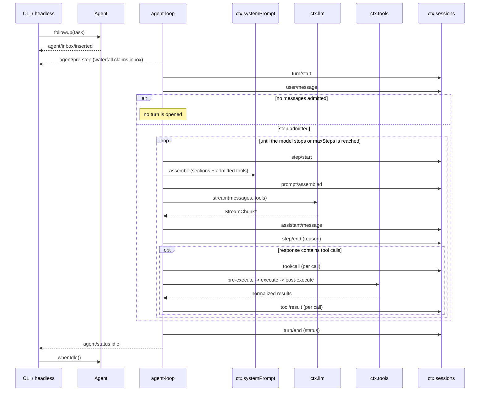

# Agent lifecycle

This is the visual companion to [architecture.md](architecture.md#turn-flow). Durable replay facts
stay on `session/event`; live control and status stay on `agent/*`.

## Ordering guarantees

- A turn is durable before its first step; an empty claimed batch opens no turn.
- `assistant/message` and `step/end` are logged before `tool/call` and execution; `tool/result`
  is logged before the next step may derive history.
- Failed and cancelled attempts still settle in the log; they are not silently dropped.
- Scoped registrations unwind before the Agent is removed from the registry.
- Prompt sections are resolved per step after tools are admitted, so a tool's guidance never
  appears without its schema.

## Model-visible means logged

Any message the model can see must be reconstructable from Session events. If a plugin wants to add
runtime context, it must append a durable event and contribute a prompt section that reads it, not
mutate an in-memory request behind the log's back.

## Implementation status

The driver implements the sequence above in `@coridis/agent-loop`:

- one Agent per `sessions.create` (or an existing `sessionId`), driven by a single draining loop;
- `agent/pre-step` is a waterfall; a claimed batch becomes one turn;
- each step assembles the prompt, streams the model call, records the assistant message, then
  executes any tool calls through the `ctx.tools` pipeline;
- the loop runs until the model returns no tool calls, the finish reason is `length`, the step cap
  is reached, or the call fails;
- `agent.lastError` exposes the fatal turn error, including a reached step cap;
- `dispose` clears the inbox, aborts in-flight work, and waits for the drain to finish.
