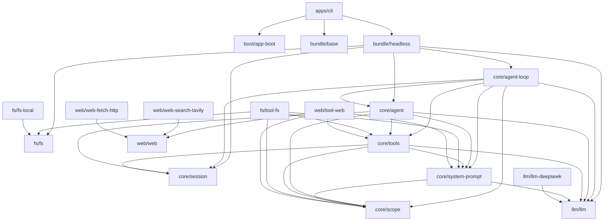

# Module graph

Arrows point from consumer to the package it imports. Every internal import is an `"*"`
dependency (linked by the npm workspace) and a matching tsconfig project reference.

## Layering rules

- `core/*` never imports a provider or a tool package.
- `llm/llm`, `fs/fs`, and `web/web` are definitions: they import only `cordis` (plus
  `schemastery` where they export a `Config` schema) and `core/scope`.
- Provider packages import their definition only.
- `tool-*` packages import definitions and `core/tools`, never a provider.
- Bundles are composition-only: their source carries no runtime API.
- `apps/cli` is the only package that knows about profiles and bundles.

## Bundles

`@coridis/base` mounts the shared rows. `@coridis/headless` mounts the startup provider and runner
and overrides `system-prompt` config. Neither bundle imports the packages it mounts; composition
happens through `cordis.patch.yml` `name` fields resolved at boot.
