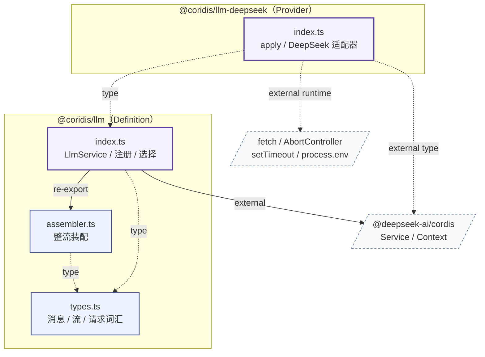
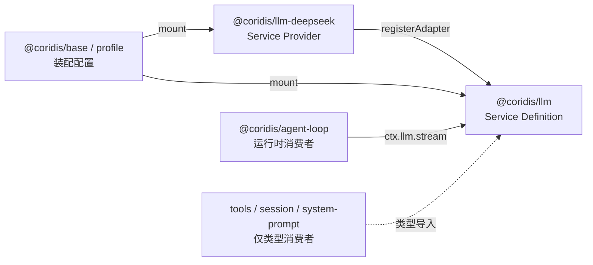
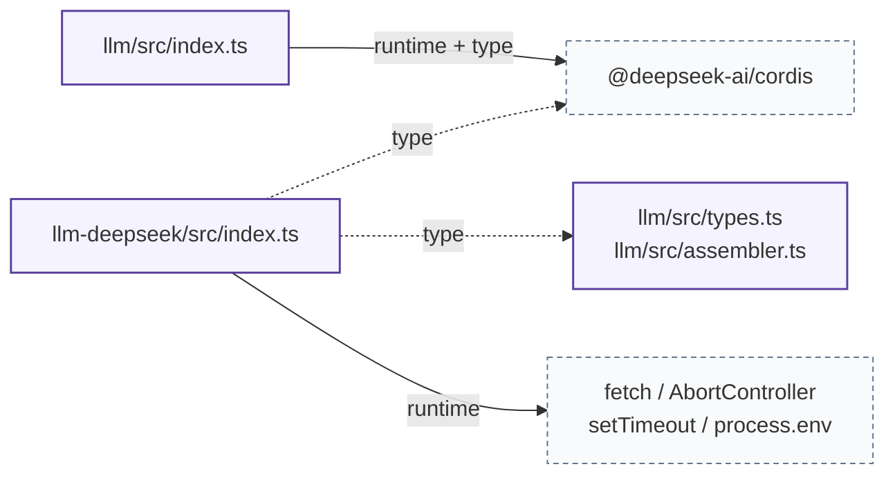

# llm 模块依赖

本模块由两个包组成：

- `@coridis/llm` —— Service Definition，拥有 `ctx.llm`、中性词汇、适配器注册表、按模型选择和流装配；
- `@coridis/llm-deepseek` —— Service Provider，只负责中性请求与 OpenAI 兼容线上格式之间的转换。

依赖是单向的：Provider 以类型方式依赖 Definition，Definition 不感知任何 Provider。

图例：

| 边 | 含义 |
|---|---|
| 实线 `value` | 运行时值导入 |
| 实线 `re-export` | `index.ts` 对外聚合导出（运行时） |
| 虚线 `type` | 仅类型导入，编译后消失 |
| 点线 `external` | 来自包外的依赖 |

## 内部文件依赖图

### 分层

| 层 | 文件 | 规则 |
|---|---|---|
| 0 · 词汇 | `types.ts` | 只有类型，没有运行时依赖 |
| 1 · 装配 | `assembler.ts` | 只依赖词汇；拼接文本、收集工具调用、读取终止原因 |
| 2 · 入口 | `index.ts` | 唯一聚合点；注册、选择、瀑布流派发 |
| Provider | `llm-deepseek/src/index.ts` | 只做线上格式映射；以类型方式依赖 Definition |

## 每个文件的内部依赖

| 文件 | 内部依赖（Kind） | 对外提供的符号 |
|---|---|---|
| `llm/src/types.ts` | 无 | `Role`、`Message`、`ContentBlock`、`ToolSchema`、`StreamRequest`、`StreamChunk`、`LlmAdapter` 等 |
| `llm/src/assembler.ts` | `types`（type） | `AssistantStreamRecord`、`assembleChunks`、`assembleStream` |
| `llm/src/index.ts` | `types`（type）、`assembler`（re-export）、`@deepseek-ai/cordis`（value + type） | `LlmService`（默认导出）、`ctx.llm` 声明、`llm/stream` 事件声明 |
| `llm-deepseek/src/index.ts` | `@coridis/llm`（type）、`@deepseek-ai/cordis`（type） | `name`、`inject`、`Config`、`apply` |

## 包级依赖与外部使用方

Definition 只提供注册、选择与派发；Provider 负责真正的网络调用；消费者按模型发起请求或只使用词汇类型。新增 Provider 不需要改消费者。

## 外部依赖列表

`Kind` 区分运行时导入（runtime）与仅类型导入（type）。

| 包 / 全局 | 使用的符号 | 使用文件 | Kind | 当前状态 |
|---|---|---|---|---|
| `@deepseek-ai/cordis` | `Service`、`Context` | `llm/src/index.ts` | runtime + type | 已安装 4.0.6-alpha.1 |
| `@deepseek-ai/cordis` | `Context` | `llm-deepseek/src/index.ts` | type | 已安装 4.0.6-alpha.1 |
| `@coridis/llm` | 词汇类型 | `llm-deepseek/src/index.ts` | type | 工作区包，解析到 `../llm/src/index.ts` |
| Node / Web 全局 | `fetch`、`AbortController`、`setTimeout`、`clearTimeout`、`process.env` | `llm-deepseek/src/index.ts` | runtime | 运行时内置，无包依赖 |

Definition 没有 I/O；网络、定时器和环境变量全部留在 Provider。

### 文件到外部依赖

## 测试与模块对应

| 规格文件 | 覆盖的模块 / 行为 |
|---|---|
| `llm/tests/llm.spec.ts` | `LlmService`：按模型选择、重复 id、模型重叠、disposer、请求透传、瀑布流包装、适配器错误透传 |
| `llm/tests/assembler.spec.ts` | `assembler.ts`：文本拼接、工具调用收集、终止原因、缺少 `finish` |
| `llm-deepseek/tests/deepseek.spec.ts` | 线上消息 / 工具映射、响应映射、API key、HTTP 与响应错误 |

## 外部使用方（被依赖情况）

| 使用方 | 使用的符号 / 行为 | 方式 |
|---|---|---|
| `@coridis/agent-loop` | `ctx.llm.stream()`、`ToolCallBlock` | runtime + type |
| `@coridis/tools` | `ToolSchema` | type |
| `@coridis/system-prompt` | `ToolSchema` | type |
| `@coridis/session` | `ContentBlock`、`Message` | type |
| `@coridis/base` / profile | 挂载 `@coridis/llm` 与 `@coridis/llm-deepseek` | 配置 |

## 维护提示

- **依赖方向**：Definition 不得导入任何 Provider；Provider 只能以类型方式导入 Definition。`types.ts` 是最底层，不得反向导入。
- **聚合入口**：新增公开符号时，只从 `llm/src/index.ts` 导出。
- **保持最小**：本层不做消息归一化、错误码、重试、调用选项、请求归属或能力目录。需要这些能力时，优先放在 `llm/stream` 监听器或 Provider 中。
- **错误契约**：适配器错误原样传播；消费者依赖原始 `message`。不要重新引入包装层。
- **模型所有权**：模型集合必须互不重叠；新增 Provider 时通过 `ctx.effect(() => ctx.llm.registerAdapter(...))` 注册，以保持可逆性。
- **I/O 边界**：网络、定时器、环境变量只应出现在 Provider 中；Definition 保持无 I/O。
- **测试**：注册、选择、瀑布流、装配或线上映射变化时，同步更新对应规格与本节表格。
