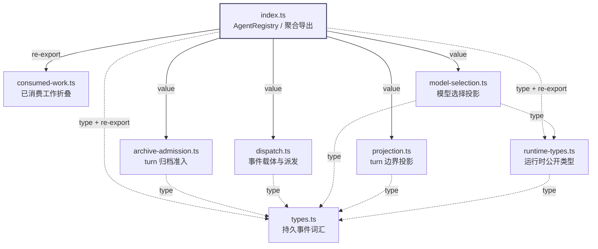

# core/agent 模块依赖

来源：deepseek-harness `packages/core/agent/src`（commit `ce7073d5`）。
图中实线表示运行时值导入，虚线表示仅类型导入；“re-export”表示 `index.ts` 聚合导出了该模块的类型。

## 内部依赖关系

依赖是单向的，没有循环：

- `types.ts` 是最底层，不依赖任何内部模块。
- `runtime-types.ts` 只依赖 `types.ts`。
- `archive-admission.ts`、`dispatch.ts`、`projection.ts` 只依赖 `types.ts`。
- `model-selection.ts` 依赖 `runtime-types.ts` 与 `types.ts`。
- `index.ts` 是唯一聚合层，导入并再导出其余模块。

## 外部依赖列表

`Kind` 区分运行时导入（runtime）与仅类型导入（type）。

| 包 | 使用的符号 | 使用模块 | Kind | 当前状态 |
|---|---|---|---|---|
| `@deepseek-ai/cordis` | `Context`, `Events`, `Fiber`, `FiberState`, `getTraceable`, `Service`, `symbols` | `index`, `archive-admission`, `dispatch`, `model-selection`, `runtime-types` | runtime + type | 已安装 4.0.6-alpha.1 |
| `@deepseek-ai/dsh-session` | `Session`, `SessionEvent`, `SessionId`, `SessionLogOffset`, `SessionSeq`, `UserMessage`, `EpochHeader`, `AgentCancelCause`, `TurnEndReason`, `OptionalSessionSeq` | `archive-admission`, `consumed-work`, `index`, `model-selection`, `projection`, `runtime-types`, `types` | type | 未安装 |
| `@deepseek-ai/dsh-scope` | `scopeTarget`; `Scoped` | `dispatch`, `index`, `runtime-types` | runtime + type | 未安装 |
| `@deepseek-ai/dsh-session-projection` | `ProjectionHandle`, `ProjectionDefinition` | `index`, `model-selection`, `projection` | type | 未安装 |
| `@deepseek-ai/dsh-llm`（含 `/brand`、`/types`） | `boundContextSummary`, `createUserMessage`, `ContextFormed`, `ReasoningEffortId`, 消息/流类型 | `model-selection`（runtime）、`runtime-types`、`types` | runtime + type | 未安装 |
| `@deepseek-ai/dsh-system-prompt` | `AssembleContext`；`declare module` 增强 | `dispatch`, `runtime-types` | type | 未安装 |
| `@deepseek-ai/dsh-workspace`（含 `/types`） | `SessionActivity`；`declare module` 增强 | `archive-admission`, `types` | type | 未安装 |
| `@deepseek-ai/dsh-typert-protocol` | `TypertContext`, `TypertLookup` | `types` | type | 未安装 |
| `@deepseek-ai/dsh-util-values` | `JsonValue` | `types` | type | 未安装 |
| `@deepseek-ai/dsh-brand` | `brandNumber` | `projection` | runtime | 未安装 |
| `zod` | `z` | `model-selection`, `projection` | runtime | 未安装 |
| `node:async_hooks` | `AsyncLocalStorage` | `index` | runtime | Node 内置 |
| `node:util/types` | `isPromise` | `index` | runtime | Node 内置 |

## 按模块看外部依赖

| 模块 | 外部包 |
|---|---|
| `index.ts` | `@deepseek-ai/cordis`（runtime）、`@deepseek-ai/dsh-scope`（runtime）、`@deepseek-ai/dsh-session`、`@deepseek-ai/dsh-session-projection`、`node:async_hooks`、`node:util/types` |
| `archive-admission.ts` | `@deepseek-ai/cordis`、`@deepseek-ai/dsh-session`、`@deepseek-ai/dsh-workspace` |
| `consumed-work.ts` | `@deepseek-ai/dsh-session` |
| `dispatch.ts` | `@deepseek-ai/cordis`、`@deepseek-ai/dsh-scope`（runtime）、`@deepseek-ai/dsh-system-prompt` |
| `model-selection.ts` | `@deepseek-ai/cordis`、`@deepseek-ai/dsh-llm`（runtime）、`@deepseek-ai/dsh-session`、`@deepseek-ai/dsh-session-projection`、`zod`（runtime） |
| `projection.ts` | `@deepseek-ai/dsh-session-projection`、`@deepseek-ai/dsh-session/types`、`@deepseek-ai/dsh-brand`（runtime）、`zod`（runtime） |
| `runtime-types.ts` | `@deepseek-ai/cordis`、`@deepseek-ai/dsh-scope`、`@deepseek-ai/dsh-llm`、`@deepseek-ai/dsh-session`、`@deepseek-ai/dsh-system-prompt` |
| `types.ts` | `@deepseek-ai/dsh-llm/brand`、`@deepseek-ai/dsh-llm/types`、`@deepseek-ai/dsh-workspace/types`、`@deepseek-ai/dsh-session/types`、`@deepseek-ai/dsh-typert-protocol`、`@deepseek-ai/dsh-util-values` |

## 移植提示

- 除 `@deepseek-ai/cordis` 外，上表中的 `@deepseek-ai/dsh-*` 与 `zod` 目前都未在本仓库安装。
- 若要让这些文件进入构建，需要先补依赖，或把 `@deepseek-ai/dsh-*` 的类型改为本仓库的对应实现/本地相对路径。
- `types.ts` 与 `runtime-types.ts` 是类型枢纽；迁移时应优先固定它们的来源，再处理 `index.ts` 的聚合导出。
